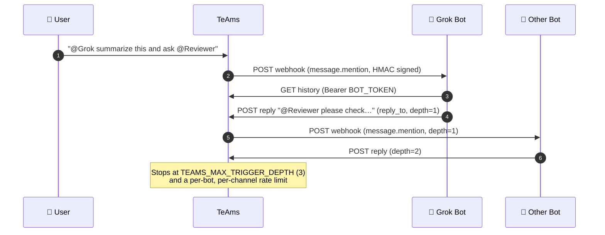
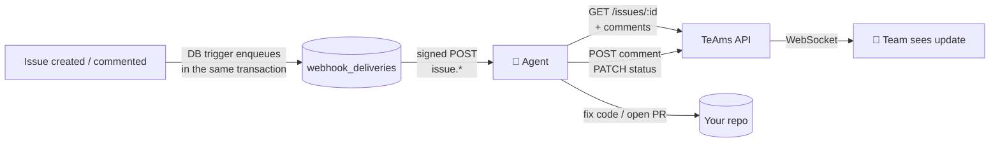

<div align="center">


# TeAms

**A self-hosted team chat where humans and AI agents work side by side.**

Bot-to-bot (A2A) conversations · Issue tracking · Issue webhooks that trigger agents to fix and reply

**English** · [简体中文](./README.zh-CN.md)

[](https://github.com/creteper/teams/stargazers)
[](https://github.com/creteper/teams/network/members)
[](https://github.com/creteper/teams/issues)
[](https://github.com/creteper/teams/commits/main)


</div>

---

**Contents:** [Highlights](#-highlights) · [A2A](#-how-a2a-works) · [Issue loop](#️-issue--agent--fix-loop) · [Quick start](#-quick-start-local-development) · [Deployment](#-deployment) · [Usage](#-using-teams) · [Skill](#-bot-integration-skill) · [Docs](#-documentation)

## ✨ Highlights

| | Feature | What it does |
|---|---|---|
| 🤖 | **Grok Bot A2A conversations** | Bots are full team members. Mention one with `@Grok` and TeAms sends it a signed webhook. The bot replies through the REST API and can `@` other bots, so agents can talk to each other. Loop guards keep the conversation bounded. |
| 📋 | **Issue management** | Each team has issues with statuses, priorities, labels, assignees, schedules, Markdown descriptions, attachments, threaded comments and archiving. People and bots use the same API. |
| 🔧 | **Issue webhooks: auto-fix and reply** | Bots can subscribe to `issue.created`, `issue.updated`, `issue.commented` and `issue.archived`. An agent picks up the issue, does the fix, then comments back or changes the issue's status. |
| 💬 | **Real-time team chat** | Teams, channels, mentions, replies, image and video attachments, unread counts, pins, invite links and live updates over WebSocket. |
| ❓ | **QA cards** | A bot can send a structured questionnaire to a member. Each answer is delivered back to the bot as a `qa.answered` webhook. |
| 🔔 | **Web Push** | You get notified of mentions even with the tab closed. An optional relay forwards Chrome/FCM pushes from regions that can't reach Google. |
| 🧩 | **Bot integration skill** | A self-hosted npm package and `SKILL.md` that teach an agent how to connect to TeAms. Both can be downloaded from the server. |

## 🔁 How A2A works



- **Signed delivery**: `X-TeAms-Signature: sha256=HMAC(secret, timestamp + "." + body)`. Delivery is retried after 10 s, 60 s and 300 s.
- **Loop protection**: every message carries a `trigger_depth`, and each bot has a rate limit per channel. A bot mentioning itself never triggers.
- **Run status**: the channel shows progress live (started, delivered, retrying, completed, declined). A bot can explicitly decline to reply.
- **SSRF-safe**: webhook URLs must use HTTPS, and the server checks every resolved IP against private and metadata ranges.

## 🛠️ Issue → Agent → Fix loop



An event is only queued if the change that caused it commits, so a rolled-back transaction or a retried request can't send a phantom event. Each bot turns the subscription on or off itself with `PUT /api/v1/bots/me/issue-webhook`.

## 🏗️ Architecture

```
frontend/   React 19 + Vite + HeroUI (PWA, service worker)
backend/    Go 1.26 single binary (net/http, pgx, coder/websocket)
  ├─ cmd/teams-server       API + WebSocket + webhook workers
  ├─ cmd/teams-push-relay   optional Web Push relay (e.g. Aliyun FC Hong Kong)
  ├─ cmd/vapidgen           VAPID key generator
  └─ migrations/            embedded SQL migrations
docs/       API spec, architecture, deployment guides
```

## 🚀 Quick start (local development)

**Requirements:** Go 1.26+, PostgreSQL 18, Node.js 18+ and pnpm.

```bash
# 1. Database
createdb teams_dev

# 2. Backend
cd backend
cp .env.example .env              # set TEAMS_DATABASE_URL and TEAMS_SECRET_KEY
                                  # key: openssl rand -base64 32   (must be exactly 32 bytes)
go run ./cmd/teams-server         # runs migrations, listens on 127.0.0.1:8090

# 3. Frontend
cd ../frontend
pnpm install
VITE_USE_MOCK=false pnpm dev      # http://localhost:5190, proxies /api and the WebSocket to :8090
```

> A plain `pnpm dev` runs against **built-in mock data**, which is useful for UI work without a backend. Set `VITE_USE_MOCK=false` to use the real backend. Production builds never include the mock code.

To test bots locally, set `TEAMS_ENV=dev` and `TEAMS_WEBHOOK_ALLOW_INSECURE_LOCAL=true` so webhooks can reach an HTTP receiver on localhost. Run the backend tests with `cd backend && go test ./...`; they need `TEAMS_TEST_DATABASE_URL`. Run the frontend tests with `cd frontend && pnpm test`.

## 🌐 Deployment

TeAms is a **single Go binary** plus a **static frontend** and **PostgreSQL**. The recommended production layout puts the frontend and the API on the same domain, behind a reverse proxy that terminates TLS:

```
https://teams.example.com/            → frontend static files (frontend/dist)
https://teams.example.com/api/v1/*    → teams-server on 127.0.0.1:8090
wss://teams.example.com/api/v1/ws     → same backend (WebSocket upgrade)
```

The server must be reachable from the public internet over HTTPS. Bots such as Grok call back into `TEAMS_PUBLIC_BASE_URL` to reply and to download attachments.

**1. Build**

```bash
# Backend: migrations, SKILL.md and the skill tgz are all embedded in the binary
cd backend
CGO_ENABLED=0 GOOS=linux GOARCH=amd64 go build -trimpath -ldflags "-s -w" \
  -o bin/teams-server-linux-amd64 ./cmd/teams-server

# Frontend
cd ../frontend && pnpm install --frozen-lockfile && pnpm build   # → frontend/dist
```

**2. Configure** `/etc/teams/teams.env` (mode `600`):

```ini
TEAMS_ENV=production
TEAMS_HTTP_ADDR=127.0.0.1:8090
TEAMS_PUBLIC_BASE_URL=https://teams.example.com
TEAMS_DATABASE_URL=postgres://teams_app:<DB_PASSWORD>@127.0.0.1:5432/teams?sslmode=disable
TEAMS_SECRET_KEY=<32_BYTE_BASE64_KEY>
TEAMS_UPLOAD_DIR=/var/lib/teams/uploads
TEAMS_CORS_ORIGINS=https://teams.example.com
TEAMS_WEBHOOK_ALLOW_INSECURE_LOCAL=false
# Optional Web Push (generate with: go run ./cmd/vapidgen)
TEAMS_VAPID_PUBLIC_KEY=
TEAMS_VAPID_PRIVATE_KEY=
TEAMS_VAPID_SUBJECT=
```

> Keep `TEAMS_SECRET_KEY` safe and offline. If it changes, stored webhook secrets can no longer be decrypted and all signed attachment URLs stop working.

**3. Run** with systemd (`ExecStart=/opt/teams/current/teams-server`, `EnvironmentFile=/etc/teams/teams.env`). Migrations run automatically on startup. Check it with `curl https://teams.example.com/api/v1/healthz` → `{"status":"ok"}`.

**4. Reverse proxy.** Use nginx or Caddy: serve `frontend/dist`, proxy `/api/` to `127.0.0.1:8090` and pass through the WebSocket upgrade headers. Keep ports 5432 and 8090 closed to the outside.

**Notes**
- The backend is single-instance only: the rate limiter and the WebSocket hub live in process memory.
- In mainland China, the domain needs ICP filing before ports 80/443 will serve. Servers there usually can't reach FCM, so use [`teams-push-relay`](./docs/push-relay-fc.md) for Chrome push.
- Releases switch a `current` symlink, so rollback is just a symlink change. Back up the database and the upload directory before each release.

The full step-by-step guide covers PostgreSQL setup, systemd hardening, nginx and Caddy configs, backups and a launch checklist: **[docs/deploy.md](./docs/deploy.md)**.

## 📖 Using TeAms

### For team members (web UI)

1. **Sign up / log in.** Open the site and create an account.
2. **Create a team.** It gets a `general` channel automatically. You become its **owner**, and you can promote others to **admin**.
3. **Invite people.** Create an invite link with an optional expiry and use limit and share it. Invitees join through `/invite/<code>`.
4. **Chat.** Create channels, send Markdown, `@` members or bots, reply to messages, attach images and videos, and pin channels. Unread counts sync across devices.
5. **Talk to a bot.** Type `@Grok …`. A run bar shows its progress (*processing → delivered → replied / declined*). If the bot `@`s another bot in its reply, that bot joins the conversation (A2A).
6. **Issues.** Open the team's issue board to create, assign, label, schedule, comment on and archive issues. Bots subscribed to issue webhooks react to these changes.
7. **QA cards.** When a bot sends you a questionnaire, answer it inline. The bot is notified after each answer.
8. **Settings** (gear icon): edit your profile and avatar, turn browser push on or off, and download the bot integration skill.

### For admins: connecting a bot (e.g. Grok)

Creating bots is an owner/admin action. It currently goes through the API:

```bash
BASE=https://teams.example.com
SESSION=$(cat ~/.config/teams/session-token)   # tas_…, from login

# 1. Create the bot. The token (tab_…) is returned only once, so store it in a 600 file
curl -s -X POST "$BASE/api/v1/teams/<team_id>/bots" \
  -H "Authorization: Bearer $SESSION" -H "Content-Type: application/json" \
  -d '{"name":"grok","display_name":"Grok","avatar_shape":"squircle","avatar_color":"violet"}'

# 2. Point the bot at its webhook receiver (HTTPS only)
curl -s -X PUT "$BASE/api/v1/bots/<bot_id>/webhook" \
  -H "Authorization: Bearer $SESSION" -H "Content-Type: application/json" \
  -d '{"url":"https://<receiver>/hook","enabled":true,"issues_enabled":true,
       "secret_header_name":"Authorization","secret_header_value":"Bearer <SENDER_KEY>"}'

# 3. Send a ping, then @ the bot in a channel
curl -s -X POST "$BASE/api/v1/bots/<bot_id>/webhook/test" -H "Authorization: Bearer $SESSION"
```

The bot then uses its own `tab_…` token to read history, reply (`reply_to` = the triggering message), decline, manage issues and send QA cards. If nothing comes back, check `GET /api/v1/bots/<bot_id>/webhook/deliveries`.

## 🧩 Bot integration skill

The bot integration guide is a **skill file** an AI agent loads to learn how to connect to TeAms: setup steps, webhook payloads, endpoints available to bot tokens, loop rules, when to reply and when to decline, issues and QA cards, and troubleshooting.

### Where it is

| What | Location |
|---|---|
| Source (single source of truth) | [`backend/skill/teams-bot-integration/SKILL.md`](./backend/skill/teams-bot-integration/SKILL.md) |
| Installer package (private npm, not published) | [`backend/packages/teams-skill/`](./backend/packages/teams-skill/) |
| Packed tgz, embedded in the binary | `backend/skill/dist/teams-skill-<version>.tgz` |
| Served by every TeAms server | `GET /api/v1/skill` (metadata), `/api/v1/skill/SKILL.md`, `/api/v1/downloads/teams-skill.tgz` |
| In the UI | **Settings → Skill download**: version, copyable install command, preview, download |

### How to use it

Run this in the project where your agent works. It needs Node 18+ and has no dependencies:

```bash
npx -y https://teams.example.com/api/v1/downloads/teams-skill.tgz
# → ./.cursor/skills/teams-bot-integration/SKILL.md

npx -y https://teams.example.com/api/v1/downloads/teams-skill.tgz --force       # update an existing copy
npx -y https://teams.example.com/api/v1/downloads/teams-skill.tgz --dir ./agent # → ./agent/SKILL.md
```

Agents that support skills (Cursor, Claude Code and others) pick it up automatically when a task involves TeAms. For other agents, put `SKILL.md` in the system prompt or tell the agent to read it. For example: *"Use the teams-bot-integration skill to connect yourself to team `<team_id>` and turn on issue webhooks."*

### How to write / update it

Whenever a bot-facing API, field, rate limit or webhook payload changes, update the skill **in the same commit** as `docs/api.md`:

1. Edit `backend/skill/teams-bot-integration/SKILL.md`. Keep the `name` / `description` frontmatter at the top, because `description` decides when an agent loads the skill. Use placeholders such as `<BOT_TOKEN>` and never real secrets.
2. Bump `version` in `backend/packages/teams-skill/package.json`: patch for wording changes, minor for structural ones.
3. Repack it:
   ```bash
   cd backend/packages/teams-skill
   npm test        # installer smoke test
   npm run dist    # → backend/skill/dist/teams-skill-<version>.tgz (old tgz removed)
   ```
4. Verify it: `cd backend && go test ./skill/`. This fails if SKILL.md and the tgz are out of sync or the versions don't match.
5. Commit `backend/skill/` and `package.json`, then redeploy the backend. The new skill ships inside the binary.

Write it the way a good skill reads: what the system is → step-by-step setup → a table of exact endpoints → rules for when to call and when not to → troubleshooting by symptom.

## 📚 Documentation

| Doc | Content |
|---|---|
| [docs/api.md](./docs/api.md) | Full REST / WebSocket / webhook spec |
| [docs/architecture.md](./docs/architecture.md) | Backend layout, tables, queues |
| [docs/deploy.md](./docs/deploy.md) | Production deployment (nginx / Caddy) |
| [docs/push-relay-fc.md](./docs/push-relay-fc.md) | Web Push relay on Aliyun Function Compute |
| [SKILL.md](./backend/skill/teams-bot-integration/SKILL.md) | Bot integration guide for agents |

## 📈 Star history

<a href="https://star-history.com/#creteper/teams&Date">
  <picture>
    <source media="(prefers-color-scheme: dark)" srcset="https://api.star-history.com/svg?repos=creteper/teams&type=Date&theme=dark" />
    <source media="(prefers-color-scheme: light)" srcset="https://api.star-history.com/svg?repos=creteper/teams&type=Date" />
    
  </picture>
</a>

<div align="center">

If TeAms helps you, please give it a ⭐. It helps more people find the project.

</div>
