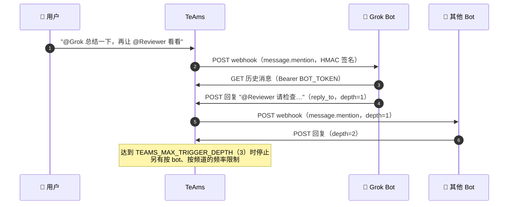
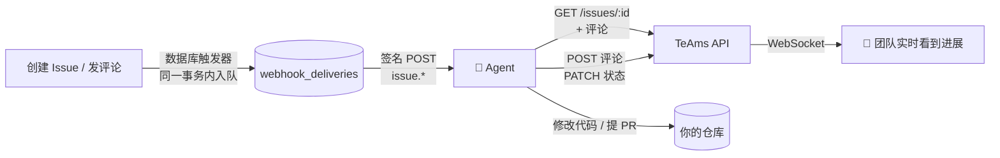

<div align="center">


# TeAms

**自托管的团队协作聊天，人和 AI Agent 一起工作。**

Bot 之间互相对话（A2A）· Issue 管理 · Issue Webhook 触发 Agent 修复并回复

[English](./README.md) · **简体中文**

[](https://github.com/creteper/teams/stargazers)
[](https://github.com/creteper/teams/network/members)
[](https://github.com/creteper/teams/issues)
[](https://github.com/creteper/teams/commits/main)


</div>

---

**目录：** [核心能力](#-核心能力) · [A2A 流程](#-a2a-对话流程) · [Issue 闭环](#️-issue--agent--修复闭环) · [快速开始](#-快速开始本地开发) · [部署](#-部署) · [使用说明](#-使用说明) · [Skill](#-bot-接入-skill) · [文档](#-文档)

## ✨ 核心能力

| | 功能 | 说明 |
|---|---|---|
| 🤖 | **Grok Bot A2A 对话** | Bot 是团队的正式成员。在消息里 `@Grok`，TeAms 会给它发一个签名 webhook。Bot 通过 REST API 回复，回复里还能 `@` 其他 bot，Agent 之间就能互相对话。防循环机制保证对话不会无限进行。 |
| 📋 | **Issue 管理** | 每个团队有自己的 Issue：状态、优先级、标签、负责人、排期、Markdown 描述、附件、楼中楼评论和归档。真人和 bot 用同一套接口。 |
| 🔧 | **Issue Webhook 触发修复和回复** | Bot 可订阅 `issue.created`、`issue.updated`、`issue.commented`、`issue.archived` 事件。Agent 收到 Issue 后去修复，再回帖或更改 Issue 状态。 |
| 💬 | **实时团队聊天** | 团队、频道、@ 提及、回复、图片和视频附件、未读数、置顶、邀请链接，通过 WebSocket 实时更新。 |
| ❓ | **QA 问答卡片** | Bot 可以给成员发结构化问卷，成员每答一题都会以 `qa.answered` webhook 回传给 bot。 |
| 🔔 | **浏览器推送** | 关掉网页也能收到 @ 提醒。在连不上 Google 的地区，可选用中转服务转发 Chrome/FCM 推送。 |
| 🧩 | **Bot 接入 Skill** | 自托管的 npm 包和 `SKILL.md`，告诉 Agent 怎么接入 TeAms，两者都可以从服务器下载。 |

## 🔁 A2A 对话流程



- **签名投递**：`X-TeAms-Signature: sha256=HMAC(secret, timestamp + "." + body)`，失败后在 10 秒、60 秒、300 秒后重试。
- **防循环**：每条消息带 `trigger_depth`，每个 bot 在每个频道有频率限制，bot @ 自己不会触发。
- **运行状态**：频道里实时显示处理进度（开始、已送达、重试、完成、不回复），bot 也可以主动声明不回复。
- **SSRF 防护**：webhook 地址必须是 HTTPS，服务器会检查每个解析出的 IP，拒绝内网和云元数据地址段。

## 🛠️ Issue → Agent → 修复闭环



只有引起事件的改动提交成功，事件才会入队，事务回滚或请求重试都不会发出不存在的事件。每个 bot 用 `PUT /api/v1/bots/me/issue-webhook` 自己开关订阅。

## 🏗️ 架构

```
frontend/   React 19 + Vite + HeroUI（PWA，Service Worker）
backend/    Go 1.26 单二进制（net/http、pgx、coder/websocket）
  ├─ cmd/teams-server       API + WebSocket + webhook 投递 worker
  ├─ cmd/teams-push-relay   可选的推送中转（如阿里云函数计算香港）
  ├─ cmd/vapidgen           VAPID 密钥生成
  └─ migrations/            内嵌 SQL 迁移
docs/       接口规范、架构、部署文档
```

## 🚀 快速开始（本地开发）

**环境要求：** Go 1.26+、PostgreSQL 18、Node.js 18+ 和 pnpm。

```bash
# 1. 数据库
createdb teams_dev

# 2. 后端
cd backend
cp .env.example .env              # 填写 TEAMS_DATABASE_URL 和 TEAMS_SECRET_KEY
                                  # 生成密钥：openssl rand -base64 32（必须正好 32 字节）
go run ./cmd/teams-server         # 自动迁移，监听 127.0.0.1:8090

# 3. 前端
cd ../frontend
pnpm install
VITE_USE_MOCK=false pnpm dev      # http://localhost:5190，/api 和 WebSocket 代理到 :8090
```

> 直接运行 `pnpm dev` 用的是**内置 mock 数据**，不启动后端也能调界面。要连真实后端，需设置 `VITE_USE_MOCK=false`。生产构建不包含 mock 代码。

本地调试 bot 时，设置 `TEAMS_ENV=dev` 和 `TEAMS_WEBHOOK_ALLOW_INSECURE_LOCAL=true`，webhook 就能发到本机的 HTTP 接收器。后端测试运行 `cd backend && go test ./...`，需要配置 `TEAMS_TEST_DATABASE_URL`；前端测试运行 `cd frontend && pnpm test`。

## 🌐 部署

TeAms 由 **一个 Go 二进制**、**一份前端静态文件**和 **PostgreSQL** 组成。生产环境推荐前端和 API 同域，放在负责 HTTPS 的反向代理后面：

```
https://teams.example.com/            → 前端静态文件（frontend/dist）
https://teams.example.com/api/v1/*    → teams-server，127.0.0.1:8090
wss://teams.example.com/api/v1/ws     → 同一个后端（WebSocket 升级）
```

服务器必须能从公网通过 HTTPS 访问：Grok 等 bot 要回调 `TEAMS_PUBLIC_BASE_URL` 来回复消息、下载附件。

**1. 构建**

```bash
# 后端：迁移、SKILL.md 和 skill tgz 都内嵌在二进制里
cd backend
CGO_ENABLED=0 GOOS=linux GOARCH=amd64 go build -trimpath -ldflags "-s -w" \
  -o bin/teams-server-linux-amd64 ./cmd/teams-server

# 前端
cd ../frontend && pnpm install --frozen-lockfile && pnpm build   # 产物在 frontend/dist
```

**2. 配置** `/etc/teams/teams.env`（权限 `600`）：

```ini
TEAMS_ENV=production
TEAMS_HTTP_ADDR=127.0.0.1:8090
TEAMS_PUBLIC_BASE_URL=https://teams.example.com
TEAMS_DATABASE_URL=postgres://teams_app:<DB_PASSWORD>@127.0.0.1:5432/teams?sslmode=disable
TEAMS_SECRET_KEY=<32_BYTE_BASE64_KEY>
TEAMS_UPLOAD_DIR=/var/lib/teams/uploads
TEAMS_CORS_ORIGINS=https://teams.example.com
TEAMS_WEBHOOK_ALLOW_INSECURE_LOCAL=false
# 可选：浏览器推送（用 go run ./cmd/vapidgen 生成）
TEAMS_VAPID_PUBLIC_KEY=
TEAMS_VAPID_PRIVATE_KEY=
TEAMS_VAPID_SUBJECT=
```

> `TEAMS_SECRET_KEY` 务必离线妥善保存。一旦更换，已保存的 webhook 密钥就无法解密，所有附件签名链接也会失效。

**3. 运行**：用 systemd 管理（`ExecStart=/opt/teams/current/teams-server`，`EnvironmentFile=/etc/teams/teams.env`）。启动时自动执行迁移。用 `curl https://teams.example.com/api/v1/healthz` 检查，返回 `{"status":"ok"}` 即正常。

**4. 反向代理**：用 nginx 或 Caddy，托管 `frontend/dist`，把 `/api/` 转发到 `127.0.0.1:8090`，并透传 WebSocket 升级头。5432 和 8090 端口不要对外开放。

**注意事项**
- 后端只支持单实例：限流器和 WebSocket hub 都在进程内存里。
- 中国大陆服务器的域名要完成 ICP 备案后 80/443 才能访问。大陆服务器通常连不上 FCM，Chrome 推送请用 [`teams-push-relay`](./docs/push-relay-fc.md) 中转。
- 发布时切换 `current` 软链接，回滚只需改回软链接。每次发布前先备份数据库和上传目录。

完整的部署手册包括 PostgreSQL 安装、systemd 加固、nginx 和 Caddy 配置、备份和上线检查清单，见 **[docs/deploy.md](./docs/deploy.md)**。

## 📖 使用说明

### 团队成员（网页端）

1. **注册 / 登录**：打开网站注册账号。
2. **创建团队**：会自动创建 `general` 频道。创建者是 **owner**，可以把其他成员设为 **admin**。
3. **邀请成员**：生成邀请链接（可设有效期和使用次数）后分享出去，对方从 `/invite/<code>` 加入。
4. **聊天**：创建频道，发 Markdown 消息，`@` 成员或 bot，回复消息，发图片和视频，置顶频道。未读数在各设备间同步。
5. **和 bot 对话**：输入 `@Grok …`，频道里的运行条会显示进度（*处理中 → 已送达 → 已回复 / 不回复*）。bot 在回复里 `@` 其他 bot，对方也会加入对话（A2A）。
6. **Issue**：打开团队的 Issue 看板，可以创建、分配、打标签、排期、评论和归档 Issue。订阅了 Issue webhook 的 bot 会响应这些变化。
7. **QA 卡片**：bot 给你发问卷时，直接在消息里作答，每答一题 bot 都会收到通知。
8. **设置**（齿轮图标）：修改个人资料和头像，开关浏览器推送，下载 bot 接入 Skill。

### 管理员：接入 bot（如 Grok）

只有 owner / admin 能创建 bot，目前要通过 API 操作：

```bash
BASE=https://teams.example.com
SESSION=$(cat ~/.config/teams/session-token)   # 登录获得的 tas_… 令牌

# 1. 创建 bot：令牌（tab_…）只返回一次，立即存入权限 600 的文件
curl -s -X POST "$BASE/api/v1/teams/<team_id>/bots" \
  -H "Authorization: Bearer $SESSION" -H "Content-Type: application/json" \
  -d '{"name":"grok","display_name":"Grok","avatar_shape":"squircle","avatar_color":"violet"}'

# 2. 配置 webhook 接收地址（必须 HTTPS）
curl -s -X PUT "$BASE/api/v1/bots/<bot_id>/webhook" \
  -H "Authorization: Bearer $SESSION" -H "Content-Type: application/json" \
  -d '{"url":"https://<receiver>/hook","enabled":true,"issues_enabled":true,
       "secret_header_name":"Authorization","secret_header_value":"Bearer <SENDER_KEY>"}'

# 3. 发一次 ping 测试，然后在频道里 @ 这个 bot
curl -s -X POST "$BASE/api/v1/bots/<bot_id>/webhook/test" -H "Authorization: Bearer $SESSION"
```

之后 bot 用自己的 `tab_…` 令牌拉历史、回复（`reply_to` 填触发消息）、声明不回复、管理 Issue、发 QA 卡片。没有回复时，查看 `GET /api/v1/bots/<bot_id>/webhook/deliveries`。

## 🧩 Bot 接入 Skill

Bot 接入指南是一个 **Skill 文件**，AI Agent 加载后就知道怎么接入 TeAms，内容包括接入步骤、webhook 载荷、bot 令牌可用的接口、防循环规则、什么时候回复或不回复、Issue 和 QA 卡片、排障。

### 在哪里

| 内容 | 位置 |
|---|---|
| 源文件（唯一来源） | [`backend/skill/teams-bot-integration/SKILL.md`](./backend/skill/teams-bot-integration/SKILL.md) |
| 安装器（私有 npm 包，不发布） | [`backend/packages/teams-skill/`](./backend/packages/teams-skill/) |
| 打包好的 tgz，内嵌进二进制 | `backend/skill/dist/teams-skill-<version>.tgz` |
| 每个 TeAms 服务器都提供 | `GET /api/v1/skill`（元信息）、`/api/v1/skill/SKILL.md`、`/api/v1/downloads/teams-skill.tgz` |
| 网页端 | **设置 → Skill 下载**：查看版本、复制安装命令、预览、下载 |

### 怎么用

在 Agent 工作的项目目录里运行（需要 Node 18+，无依赖）：

```bash
npx -y https://teams.example.com/api/v1/downloads/teams-skill.tgz
# → ./.cursor/skills/teams-bot-integration/SKILL.md

npx -y https://teams.example.com/api/v1/downloads/teams-skill.tgz --force       # 更新已有文件
npx -y https://teams.example.com/api/v1/downloads/teams-skill.tgz --dir ./agent # → ./agent/SKILL.md
```

支持 Skill 的 Agent（Cursor、Claude Code 等）在任务涉及 TeAms 时会自动加载它。其他 Agent 可以把 `SKILL.md` 放进系统提示词，或让 Agent 先读这个文件，例如：*"按 teams-bot-integration skill 把你接入团队 `<team_id>`，并开启 Issue webhook。"*

### 怎么写 / 更新

面向 bot 的接口、字段、限流或 webhook 载荷有任何变化，都要和 `docs/api.md` **在同一个提交里**更新 Skill：

1. 修改 `backend/skill/teams-bot-integration/SKILL.md`。保留开头的 `name` / `description` frontmatter，Agent 根据 `description` 决定什么时候加载这个 Skill。密钥一律写成 `<BOT_TOKEN>` 这样的占位符，不写真实值。
2. 升级 `backend/packages/teams-skill/package.json` 里的 `version`：文字改动升 patch，结构变化升 minor。
3. 重新打包：
   ```bash
   cd backend/packages/teams-skill
   npm test        # 安装器冒烟测试
   npm run dist    # 生成 backend/skill/dist/teams-skill-<version>.tgz，并删除旧 tgz
   ```
4. 校验：`cd backend && go test ./skill/`。SKILL.md 和 tgz 不一致、或版本号对不上时会失败。
5. 提交 `backend/skill/` 和 `package.json`，然后重新部署后端，新 Skill 随二进制一起上线。

写法建议：先说明系统是什么 → 分步接入 → 列出精确的接口表 → 什么时候该调、什么时候不该调 → 按现象排障。

## 📚 文档

| 文档 | 内容 |
|---|---|
| [docs/api.md](./docs/api.md) | 完整的 REST / WebSocket / Webhook 规范 |
| [docs/architecture.md](./docs/architecture.md) | 后端结构、数据表、投递队列 |
| [docs/deploy.md](./docs/deploy.md) | 生产部署（nginx / Caddy） |
| [docs/push-relay-fc.md](./docs/push-relay-fc.md) | 用阿里云函数计算中转推送 |
| [SKILL.md](./backend/skill/teams-bot-integration/SKILL.md) | 给 Agent 的 bot 接入指南 |

## 📈 Star 增长曲线

<a href="https://star-history.com/#creteper/teams&Date">
  <picture>
    <source media="(prefers-color-scheme: dark)" srcset="https://api.star-history.com/svg?repos=creteper/teams&type=Date&theme=dark" />
    <source media="(prefers-color-scheme: light)" srcset="https://api.star-history.com/svg?repos=creteper/teams&type=Date" />
    
  </picture>
</a>

<div align="center">

如果 TeAms 对你有帮助，欢迎点个 ⭐，让更多人看到这个项目。

</div>
